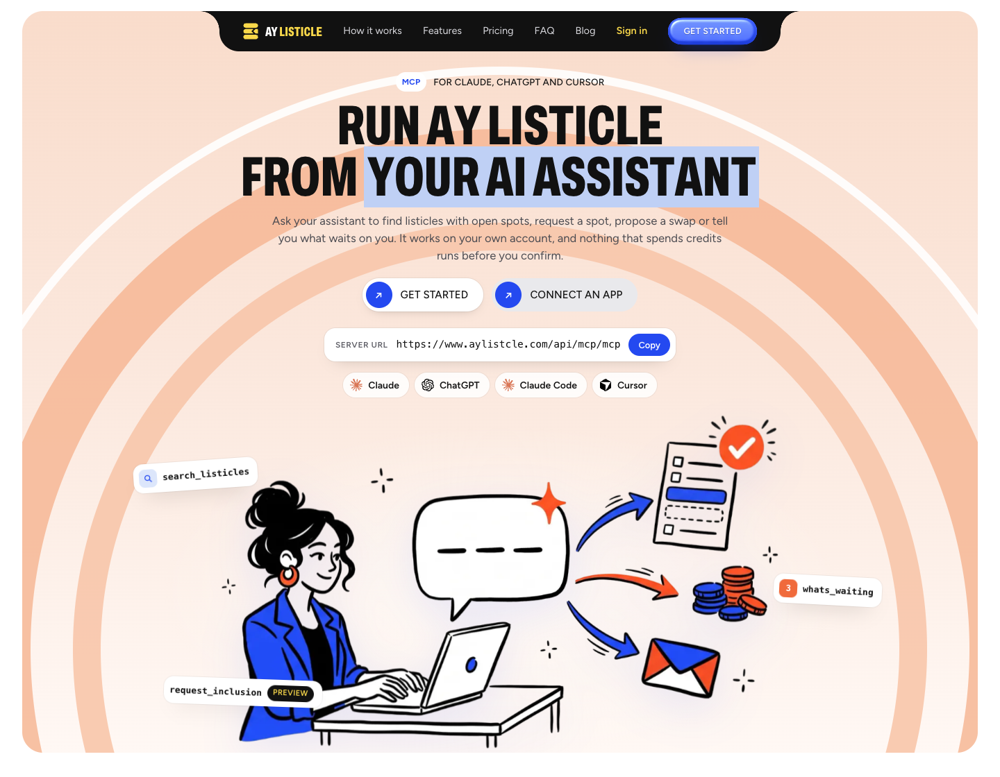
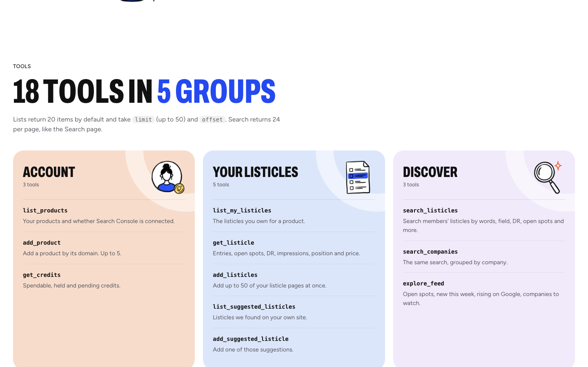
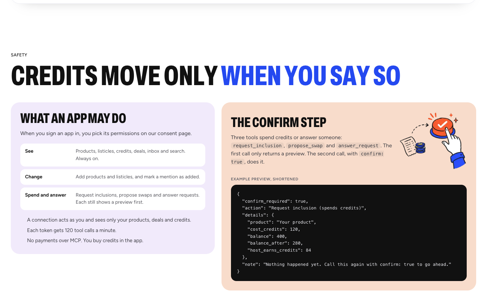

<p align="center">
  
</p>

# AY Listicle MCP server

Use your [AY Listicle](https://www.aylistcle.com) account from Claude, ChatGPT, Claude Code, Cursor, VS Code, Windsurf, Zed, Gemini CLI and any other app that speaks the Model Context Protocol.

- **Server URL:** `https://www.aylistcle.com/api/mcp/mcp` (Streamable HTTP, hosted by AY Listicle, nothing to install)
- **Sign-in:** OAuth, or a personal access token in an `Authorization` header
- **Tools:** 18, in five groups
- **Safety:** anything that spends credits or answers another member shows a preview first and waits for your `confirm: true`



## What is AY Listicle?

AY Listicle is a network where companies get featured in each other's best-of listicles. A member adds other members' products to a listicle they own, and other members add theirs. Every inclusion is an editorial decision: the host reads the request and approves or declines it. We check both pages with a crawler and recheck every month.

AY Listicle makes no promises about rankings, traffic or results. It is a way to be included, by hand, in lists that people read.

Credits pay for inclusions. The host approves every request and earns a share of the credits after the crawler check and a waiting period. Current numbers are on the [site](https://www.aylistcle.com).

## What the MCP server does

MCP is how AI apps call outside tools. This server gives your assistant the same actions you have in the AY Listicle app: search other members' listicles, check your credits, request a spot, propose a swap and answer requests. You type what you want, and the assistant picks the tool. It only ever sees your own products, deals and credits.

### Tools

| Group | Tool | What it does | Spends credits |
|---|---|---|---|
| Account | `list_products` | Your products, their ids and whether Search Console is connected | No |
| Account | `add_product` | Add a product by its website (up to 5 per account, one account per site) | No |
| Account | `get_credits` | Spendable, held and pending credits | No |
| Your listicles | `list_my_listicles` | The listicles you own for a product, with status, open spots, price and Search Console numbers | No |
| Your listicles | `get_listicle` | One listicle: entries, open spots, DR, impressions, average position and price. Works for yours and for active listicles in the network | No |
| Your listicles | `add_listicles` | Add up to 50 of your own listicle pages to a product | No |
| Your listicles | `list_suggested_listicles` | Listicles we found on your own site, most-read first | No |
| Your listicles | `add_suggested_listicle` | Add one suggested listicle to its product | No |
| Discover | `search_listicles` | Search other members' listicles by words, field, DR, open spots, Search Console data and sort | No |
| Discover | `search_companies` | The same search, grouped by company | No |
| Discover | `explore_feed` | Open spots, new this week, rising on Google and companies that just joined | No |
| Deals | `list_deals` | Your swaps and inclusion requests, with status and whose turn it is | No |
| Deals | `whats_waiting` | Everything waiting on you, most urgent first | No |
| Deals | `request_inclusion` | Ask a host to include your product in their listicle | **Yes** (held until the host answers). Preview first, needs `confirm: true` |
| Deals | `propose_swap` | Ask another member for a free swap of spots. Emails them | No credits. Preview first, needs `confirm: true` |
| Deals | `answer_request` | Accept or decline a request sent to you, or cancel one you sent | Can release held credits or earn credits. Preview first, needs `confirm: true` |
| Deals | `mark_mention_added` | Tell us you added a mention so the crawler checks it | No |
| Inbox | `read_inbox` | Swap and inclusion updates, requests waiting on you and failed checks | No |

Lists take `limit` (up to 50) and `offset`. Search returns 24 per page.

### Example prompts

- "What's waiting on me this week?"
- "Show me listicles in cold email with an open spot and DR above 50."
- "How many credits do I have, and how many are held?"
- "Add these 12 listicle URLs from my blog to my product."
- "Request a spot in the second one. Show me the preview first."
- "Propose a swap to the host of the third listicle."
- "Accept the request from Fluxmail, but show me what I get first."
- "I added the mention. Tell the crawler to check it."



## Connect

You need an AY Listicle account ([sign up](https://www.aylistcle.com/signup)). Other members' listicles show as locked rows (numbers only) until the account has a plan.

### Claude.ai, Claude Desktop and Claude mobile (sign in)

1. Open Settings, then Connectors.
2. Choose Add custom connector.
3. Paste `https://www.aylistcle.com/api/mcp/mcp` and save.
4. Press Connect, sign in to AY Listicle and choose what Claude may do (see Permissions below).

Claude Desktop's config file can also reach the server through `mcp-remote` with a token. Needs Node.js:

```json
{
  "mcpServers": {
    "aylistcle": {
      "command": "npx",
      "args": [
        "-y", "mcp-remote@0.15.2",
        "https://www.aylistcle.com/api/mcp/mcp",
        "--header", "Authorization:${AYL_AUTH}"
      ],
      "env": { "AYL_AUTH": "Bearer ayl_your_token" }
    }
  }
}
```

### Claude Code (sign in)

```bash
claude mcp add --transport http aylistcle https://www.aylistcle.com/api/mcp/mcp
```

Then run `/mcp` inside Claude Code, pick `aylistcle` and choose Authenticate.

Or install the plugin, which also adds the `aylistcle` skill:

```bash
/plugin marketplace add tahalatif-cmd/aylistcle-mcp
/plugin install aylistcle@aylistcle
```

To use a token instead of signing in:

```bash
claude mcp add --transport http aylistcle https://www.aylistcle.com/api/mcp/mcp \
  --header "Authorization: Bearer ayl_your_token"
```

### Cursor (token)

Put this in `~/.cursor/mcp.json`, or `.cursor/mcp.json` in a project:

```json
{
  "mcpServers": {
    "aylistcle": {
      "url": "https://www.aylistcle.com/api/mcp/mcp",
      "headers": { "Authorization": "Bearer ayl_your_token" }
    }
  }
}
```

Cursor can also sign in with OAuth if you leave `headers` out.

### ChatGPT (sign in)

Add the server as a connector (an app with a custom MCP server). In ChatGPT, open Settings, then Apps or Connectors, turn on developer mode under Advanced settings if your plan requires it, and create a new connector with the URL `https://www.aylistcle.com/api/mcp/mcp` and OAuth as the authentication. ChatGPT starts the AY Listicle sign-in itself.

### VS Code

Add to `.vscode/mcp.json` (or run "MCP: Add Server" and choose HTTP):

```json
{
  "servers": {
    "aylistcle": {
      "type": "http",
      "url": "https://www.aylistcle.com/api/mcp/mcp"
    }
  }
}
```

VS Code opens the sign-in the first time a tool runs. To use a token, add `"headers": { "Authorization": "Bearer ayl_your_token" }`.

### Windsurf

Add to `~/.codeium/windsurf/mcp_config.json`:

```json
{
  "mcpServers": {
    "aylistcle": {
      "serverUrl": "https://www.aylistcle.com/api/mcp/mcp",
      "headers": { "Authorization": "Bearer ayl_your_token" }
    }
  }
}
```

### Zed

Add to Zed's `settings.json`:

```json
{
  "context_servers": {
    "aylistcle": {
      "url": "https://www.aylistcle.com/api/mcp/mcp",
      "headers": { "Authorization": "Bearer ayl_your_token" }
    }
  }
}
```

### Gemini CLI

```bash
gemini mcp add --transport http aylistcle https://www.aylistcle.com/api/mcp/mcp
```

With a token:

```bash
gemini mcp add --transport http --header "Authorization: Bearer ayl_your_token" \
  aylistcle https://www.aylistcle.com/api/mcp/mcp
```

Or install this repository as an extension: `gemini extensions install https://github.com/tahalatif-cmd/aylistcle-mcp`.

### Any other MCP client

Point it at `https://www.aylistcle.com/api/mcp/mcp` with the Streamable HTTP transport. Clients that support OAuth discover the sign-in on their own (`/.well-known/oauth-protected-resource`). Clients that do not can send `Authorization: Bearer ayl_...`.

## Sign-in and tokens

**OAuth.** The server follows the MCP authorization spec: PKCE, dynamic client registration or client ID metadata documents, and tokens bound to this server. You approve what an app may do on the AY Listicle consent page.

| Permission | What it allows |
|---|---|
| See (always on) | Products, listicles, credits, deals, inbox and search |
| Change | Add products and listicles, mark a mention as added |
| Spend and answer | Request inclusions, propose swaps, answer requests. Each still shows a preview first |

**Personal tokens.** In the app open Settings, then AI assistants (MCP), name a token and press Create token. It starts with `ayl_`, is shown once and only its hash is stored. A token acts as you, so keep it private. Each connection is limited to 120 tool calls a minute.

**Disconnecting.** Revoke a connected app or a token in Settings, under AI assistants (MCP). It stops working on its next call.

## Safety

- Every tool runs as you and only sees your own products, deals and credits.
- `request_inclusion`, `propose_swap` and `answer_request` only return a preview until they are called again with `confirm: true`. The preview says what will happen, the cost and your balance after.
- An app you signed in also needs the Spend and answer permission before those three tools work at all.
- No payments over MCP. Buying credits happens in the app.
- The host approves every request. Nothing is added to a listicle without that decision.



## Skill

`skills/aylistcle/SKILL.md` is a ready-made skill that teaches an assistant how to find listicles and request inclusion safely, always previewing first. It loads automatically when you install the Claude Code plugin, and you can copy it into any agent that reads `SKILL.md` files.

## Links

- Website: https://www.aylistcle.com
- MCP page (setup, FAQ): https://www.aylistcle.com/mcp
- Privacy: https://www.aylistcle.com/privacy
- Terms: https://www.aylistcle.com/terms
- Refunds: https://www.aylistcle.com/refund
- Contact: https://www.aylistcle.com/contact or team@aylistcle.com

## About this repository

This repository holds the public listing material for the hosted server: this README, `server.json` for the MCP Registry, the Claude Code plugin and Gemini CLI extension manifests, and a skill. There is no server code here. The server itself is run by AY Automate LLC.

## License

The contents of this repository are released under the [MIT License](LICENSE). Use of the hosted AY Listicle service is covered by the [Terms](https://www.aylistcle.com/terms).

Copyright (c) 2026 AY Automate LLC.
